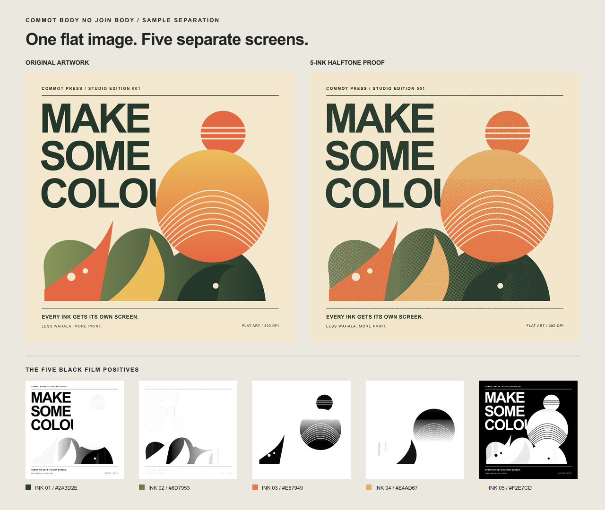

# COMMOT BODY NO JOIN BODY

**Turn one flat design into separate screen-printing inks.**

Choose an ink budget from **3 to 8 colors**. The plugin finds a compact palette, lets you edit each ink, and separates the visible Photoshop composite into nonoverlapping screens. It scans **every source pixel** when suggesting inks and writes outputs at the artwork's original dimensions and DPI.

## Load it in Photoshop

Requires **Photoshop 25.0 or newer**, on macOS or Windows. This download is an unpackaged UXP plugin project; Adobe's UXP Developer Tool loads it into Photoshop. There are no npm packages, build commands, accounts, servers, or API keys to configure.

1. Extract the ZIP to a permanent folder.
2. Install **UXP Developer Tool** from Adobe Creative Cloud Desktop. See [Adobe's developer tool setup](https://developer.adobe.com/uxp/guides/how-to/developer-tools/).
3. Open Photoshop. In **Settings / Preferences → Plugins**, enable **Developer Mode**. Enable Developer Mode in UXP Developer Tool too if prompted. Restart Photoshop if requested.
4. In UXP Developer Tool, choose **Add Plugin** and select **`plugin/manifest.json`** inside this folder.
5. Choose **Load** for the plugin, with Photoshop running.
6. In Photoshop, open **Plugins → COMMOT BODY NO JOIN BODY**.

Follow [Adobe's UDT loading walkthrough](https://developer.adobe.com/uxp/guides/how-to/udt-deep-dive/) if the host does not appear. Keep the extracted project folder in place; UDT loads those files directly. To distribute a packaged `.ccx` installer later, use Adobe's UXP packaging workflow and your own plugin identity.

## Separate a design

1. Open a flat JPG, PNG or TIFF, or a PSD whose visible layers form your finished design. Set the final canvas dimensions and print resolution first.
2. Click **Read active artwork**. The visible composite is captured, including transparency. Hidden layers are excluded.
3. Choose **3–8** as the maximum number of inks. Art with fewer actual colors can produce fewer screens, avoiding duplicate inks.
4. Choose a separation mode:
   - **Solid inks:** nearest perceptual color; useful for logos, type and flat illustrations.
   - **Halftone tones:** clustered dots blend pairs of inks to preserve gradients, shading and soft edges. Set LPI and angle for the intended press. The UI requires at least four source pixels per halftone cell.
5. Leave **Print every color** selected, or choose a white, black or custom shirt/paper color to leave unprinted. Start with a low background tolerance so light or dark artwork detail survives. **Tolerance 0** removes only the exact substrate color.
6. Edit any ink's **six-digit HEX** value to change its color. The design is reassigned to the edited palette. Click a swatch to inspect that screen's black film preview. **Auto palette** recalculates all inks.
7. Click **Create ink layers** or **Export 1-bit print films (.TIFF)**.

If you edit the source after capturing it, read it again. The plugin rejects stale captures before output. Cancel a long operation with the panel's Cancel button or Photoshop's Escape cancellation when available.

## What you receive

**Create ink layers** makes a new 8-bit sRGB document with one opaque-color pixel layer per ink, on transparent pixels. Each layer is named `INK 01 • #HEX`. The original document is preserved. Save the new document as a PSD using Photoshop.

**Export print films** asks for a destination folder and creates a new, uniquely named job subfolder containing:

- One **true 1-bit, uncompressed TIFF** per ink: black = print this ink; white = leave clear.
- **INK-MAP.json** with sRGB color targets, coverage, dimensions, source DPI and separation settings.
- **PRINT-NOTES.txt** with output notes.

All films share the exact same canvas and source DPI. Output is tiled to bound working memory; halftone coordinates stay aligned across tile boundaries. Film TIFFs contain binary pixels with no anti-aliasing. Layer alpha is binary too. Cancelled or failed jobs are cleaned up where the host allows it.

## Keeping the most detail

The palette uses edge-weighted, population-tempered color clustering in perceptual OKLab. Small contrasting details receive extra influence. Every source pixel contributes; full-resolution output uses the same global palette. Halftones fit two-ink area mixtures in linear-light sRGB and use a common clustered-dot screen to avoid overlapping plates.

Increasing the ink count usually improves color fidelity. Reducing a photograph to a few inks always changes its appearance. An automatic result cannot guarantee the best palette for every design; edit the ink colors or compare different counts when a small accent matters.

The preview is reduced to fit the panel and encoded as JPEG **only for display**. It is not a minimum-dot or full-resolution proof. Outputs use original pixels, never JPEG. Inspect exported TIFFs at **100%**, and print films at **actual size** with fit-to-page and additional printer halftoning disabled.

The plugin creates **nonoverlapping spot-color plates** and sRGB visual targets. It does not select commercial ink formulas, simulate ink opacity/dot gain, or add white underbase, choke, trapping, registration marks or mirrored output. Plan these press choices separately. Test the chosen mesh, LPI and minimum dot on the intended substrate. Semi-transparent edges become crisp binary shapes in solid mode or dot-area coverage in halftone mode.

## Try the included sample

- [Flat sample artwork](sample/flat-artwork.png): a 1500 × 1500 flat design at 300 DPI.
- [Five-ink proof](sample/five-ink-proof.png): the engine's five-color halftone result.
- [Individual print films](sample/five-ink-films/): five actual 1-bit TIFF positives and an ink map.
- [Browser demonstration](demo/preview.html): an offline browser demonstration with the sample preloaded. Download the project and open this HTML file locally. Output buttons are disabled there; the Photoshop plugin provides full-resolution output.

## Validation and current status

The pure engine, controller and mocked Photoshop workflows are tested. TIFF files were independently decoded to check 1-bit depth, polarity, odd-width row padding, pixel identity and fractional DPI. Tests cover source preservation, tile alignment, cancellations, stale source rejection, transparency, full-resolution palette analysis and exact 3-/8-color flat artwork.

**The panel has not yet been loaded and tested in a real Photoshop session.** UXP Developer Tool was unavailable in the build environment, so native panel layout and live host behavior still need that final check. This is a working source release for loading and testing, with the limits above recorded explicitly.

For developer checks, install Node.js 18+ and run `node tests/engine-tests.cjs`, `node tests/host-tests.cjs`, and `node tests/ui-tests.cjs` from this folder. No dependencies are needed for those tests. `tests/tiff-decode.py` optionally checks the sample films with Python + Pillow.

## Adobe API references

- [Photoshop Imaging API](https://developer.adobe.com/photoshop/uxp/2022/ps-reference/media/imaging): composite capture, pixel layers, display encoding and resource disposal.
- [Modal execution](https://developer.adobe.com/photoshop/uxp/2022/ps-reference/media/executeasmodal): document edits, cancellation, grouped history and incomplete document cleanup.
- [UXP Manifest v5](https://developer.adobe.com/photoshop/uxp/2022/guides/uxp-guide/uxp-misc/manifest-v5/): panel registration and picker-based local filesystem permission.

All artwork processing runs locally. The plugin requests folder-picker access for exports and has no network permission.
